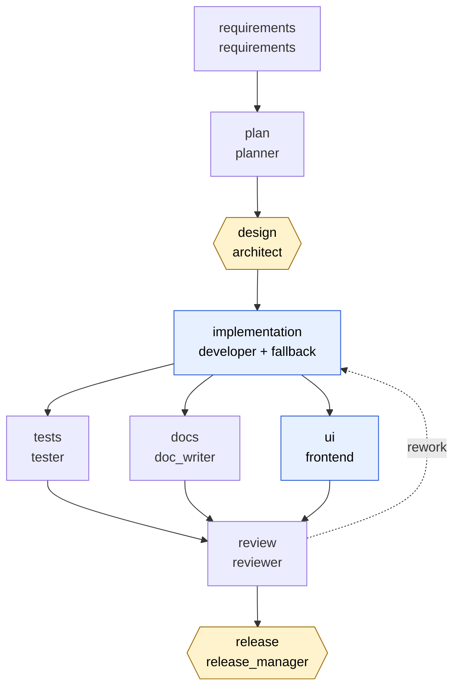
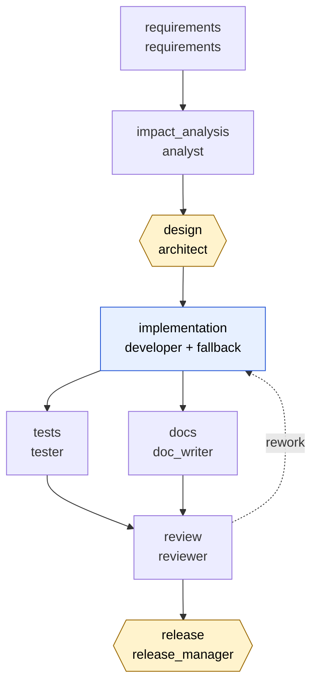
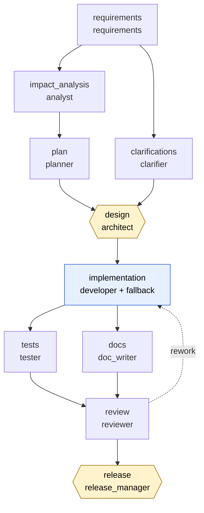
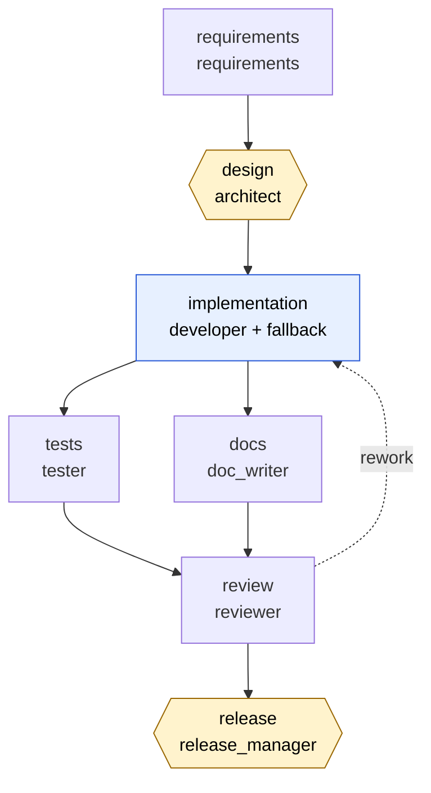

<!-- GENERATED FILE: do not edit by hand. Regenerate with:  python scripts/gen_architecture_docs.py
     A test fails if this file is out of date. Everything here is read from the real code. -->

# Architecture reference (generated)

Companion to [architecture.md](architecture.md). Everything below is produced from the running code by `scripts/gen_architecture_docs.py`.

## 1. Workflow graphs and the controls on every stage

### 1.1 Greenfield: the URL shortener (with plan and web UI)

*Hexagons need a human approval; blue boxes produce code and carry a security gate; the arrows are dependencies (redundant ones omitted); the dashed arrow is a rejection sent back for rework.*

| Stage | Agent | Entry controls | Exit controls (every one must pass) | Human / rework |
|---|---|---|---|---|
| `requirements` | requirements | - | json_has_keys(goal, functional, ambiguities, acceptance) | - |
| `design` | architect | require_inputs(requirements) | - | human approval |
| `implementation` | developer (+ developer_fallback) | - | valid_python security/no-hardcoded-secrets security/no-dangerous-calls security/no-unsafe-imports security/dependency-allowlist compliance/public-api-documented change_control/max-files-changed change_control/max-lines-changed change_control/protected-paths change_control/no-file-deletion | - |
| `tests` | tester | - | valid_python tests_pass_against_implementation compliance/minimum-tests compliance/traceability-evidence-exists | - |
| `docs` | doc_writer | - | compliance/docs-cover-public-api | - |
| `review` | reviewer | - | reviewer_approves | rejection sent back to `implementation` |
| `release` | release_manager | compliance/release-evidence | - | human approval |
| `plan` | planner | - | compliance/plan-well-formed compliance/plan-maps-to-workflow compliance/plan-sequencing-matches-graph compliance/acceptance-criteria-traced | - |
| `ui` | frontend | - | security/no-hardcoded-secrets security/ui-no-external-resources security/ui-no-unsafe-dom-sinks security/ui-no-inline-event-handlers security/ui-no-inline-style-attributes security/ui-csp-compatible-blocks compliance/ui-uses-documented-api compliance/ui-accessibility-basics change_control/max-files-changed change_control/max-lines-changed change_control/protected-paths change_control/no-file-deletion | - |

### 1.2 Brownfield: fixing BUG-142 in the existing service

*Hexagons need a human approval; blue boxes produce code and carry a security gate; the arrows are dependencies (redundant ones omitted); the dashed arrow is a rejection sent back for rework.*

| Stage | Agent | Entry controls | Exit controls (every one must pass) | Human / rework |
|---|---|---|---|---|
| `requirements` | requirements | - | json_has_keys(goal, functional, ambiguities, acceptance) | - |
| `impact_analysis` | analyst | - | json_has_keys(impacted, root_cause, risks) compliance/impact-analysis-grounded | - |
| `design` | architect | require_inputs(requirements, impact_analysis) | - | human approval |
| `implementation` | developer (+ developer_fallback) | - | valid_python security/no-hardcoded-secrets security/no-dangerous-calls security/no-unsafe-imports security/dependency-allowlist compliance/public-api-documented change_control/max-files-changed change_control/max-lines-changed change_control/protected-paths change_control/no-file-deletion change_control/public-api-stable change_control/change-within-declared-impact | - |
| `tests` | tester | - | valid_python tests_pass_against_implementation compliance/minimum-tests compliance/no-tests-removed compliance/regression-test-reproduces-bug | - |
| `docs` | doc_writer | - | compliance/changelog-references-ticket | - |
| `review` | reviewer | - | reviewer_approves | rejection sent back to `implementation` |
| `release` | release_manager | compliance/release-evidence | - | human approval |

### 1.3 Ambiguous: "make links expire sensibly"

*Hexagons need a human approval; blue boxes produce code and carry a security gate; the arrows are dependencies (redundant ones omitted); the dashed arrow is a rejection sent back for rework.*

| Stage | Agent | Entry controls | Exit controls (every one must pass) | Human / rework |
|---|---|---|---|---|
| `requirements` | requirements | - | json_has_keys(goal, functional, ambiguities, acceptance) | - |
| `clarifications` | clarifier | - | compliance/decisions-cover-ambiguities compliance/high-risk-needs-human compliance/answers-within-options compliance/assumptions-have-rationale compliance/decisions-consistent | - |
| `impact_analysis` | analyst | - | json_has_keys(impacted, root_cause, risks) compliance/impact-analysis-grounded | - |
| `plan` | planner | - | compliance/plan-well-formed compliance/plan-maps-to-workflow compliance/plan-sequencing-matches-graph compliance/acceptance-criteria-traced | - |
| `design` | architect | require_inputs(requirements, impact_analysis, clarifications) | - | human approval |
| `implementation` | developer (+ developer_fallback) | - | valid_python security/no-hardcoded-secrets security/no-dangerous-calls security/no-unsafe-imports security/dependency-allowlist compliance/public-api-documented change_control/max-files-changed change_control/max-lines-changed change_control/protected-paths change_control/no-file-deletion change_control/public-api-stable change_control/change-within-declared-impact compliance/implementation-honours-decisions | - |
| `tests` | tester | - | valid_python tests_pass_against_implementation compliance/minimum-tests compliance/no-tests-removed compliance/regression-test-reproduces-bug compliance/traceability-evidence-exists | - |
| `docs` | doc_writer | - | compliance/changelog-references-ticket | - |
| `review` | reviewer | - | reviewer_approves | rejection sent back to `implementation` |
| `release` | release_manager | compliance/release-evidence | - | human approval |

### 1.4 Toy: a small function (the cheapest real-model test)

*Hexagons need a human approval; blue boxes produce code and carry a security gate; the arrows are dependencies (redundant ones omitted); the dashed arrow is a rejection sent back for rework.*

| Stage | Agent | Entry controls | Exit controls (every one must pass) | Human / rework |
|---|---|---|---|---|
| `requirements` | requirements | - | json_has_keys(goal, functional, ambiguities, acceptance) | - |
| `design` | architect | require_inputs(requirements) | - | human approval |
| `implementation` | developer (+ developer_fallback) | - | valid_python security/no-hardcoded-secrets security/no-dangerous-calls security/no-unsafe-imports security/dependency-allowlist compliance/public-api-documented change_control/max-files-changed change_control/max-lines-changed change_control/protected-paths change_control/no-file-deletion | - |
| `tests` | tester | - | valid_python tests_pass_against_implementation compliance/minimum-tests | - |
| `docs` | doc_writer | - | compliance/docs-cover-public-api | - |
| `review` | reviewer | - | reviewer_approves | rejection sent back to `implementation` |
| `release` | release_manager | compliance/release-evidence | - | human approval |

## 2. Policy catalogue (discovered from the code)

Each policy is a named rule; a violation always reads `[category/id] message`. Rationale and examples: [policies.md](policies.md).

| Category | Policy id | What it enforces |
|---|---|---|
| change_control | `change-within-declared-impact` | A patch may only touch what the analysis declared |
| change_control | `max-files-changed` | Bound how many files one change may touch |
| change_control | `max-lines-changed` | Bound the size of one change |
| change_control | `no-file-deletion` | Deleting files needs a human, not an agent |
| change_control | `protected-paths` | Agents may not touch credentials, CI or secrets |
| change_control | `public-api-stable` | Do not break existing callers |
| compliance | `acceptance-criteria-traced` | Every acceptance criterion maps to tasks and verification |
| compliance | `answers-within-options` | Answers must be one of the supported options |
| compliance | `assumptions-have-rationale` | An assumed answer must say why |
| compliance | `changelog-references-ticket` | Every fix is traceable to its ticket |
| compliance | `decisions-consistent` | Answers must not contradict each other |
| compliance | `decisions-cover-ambiguities` | Every open question gets a recorded decision |
| compliance | `docs-cover-public-api` | Docs must mention every public function/class |
| compliance | `high-risk-needs-human` | Agents may not assume answers to high-risk questions |
| compliance | `impact-analysis-grounded` | Impact analysis may only name symbols that exist |
| compliance | `implementation-honours-decisions` | Human decisions must be visible in the code |
| compliance | `minimum-tests` | At least 3 tests must accompany the code |
| compliance | `no-tests-removed` | A fix may add tests, never delete them |
| compliance | `plan-maps-to-workflow` | Every task maps to a real stage; every key stage is planned |
| compliance | `plan-sequencing-matches-graph` | The plan's ordering must be executable as written |
| compliance | `plan-well-formed` | Unique ids, valid dependencies, no cycles |
| compliance | `public-api-documented` | Every public function/class needs a docstring |
| compliance | `regression-test-reproduces-bug` | New tests must fail on the old code |
| compliance | `release-evidence` | Release needs every artifact plus an approving review |
| compliance | `traceability-evidence-exists` | Promised tests and gates must really exist |
| compliance | `ui-accessibility-basics` | lang, title and labelled form controls |
| compliance | `ui-uses-documented-api` | The UI must be wired to the documented API |
| security | `dependency-allowlist` | Third-party imports must be pre-approved |
| security | `no-dangerous-calls` | No eval/exec/os.system/subprocess |
| security | `no-hardcoded-secrets` | Source must not embed credentials |
| security | `no-unsafe-imports` | No modules that enable arbitrary code or memory access |
| security | `ui-csp-compatible-blocks` | Inline blocks must be hashable by the CSP builder |
| security | `ui-no-external-resources` | A UI may not pull code or assets from other hosts |
| security | `ui-no-inline-event-handlers` | Use addEventListener so a strict CSP can apply |
| security | `ui-no-inline-style-attributes` | Style attributes cannot be covered by the CSP hash |
| security | `ui-no-unsafe-dom-sinks` | No innerHTML/eval/document.write: render data as text |
| change_control (workflow lint) | `code-requires-security-gate` | a node tagged code must carry a security exit gate |
| change_control (workflow lint) | `high-impact-requires-approval` | a node tagged high_impact must require human approval |
| change_control (workflow lint) | `release-requires-compliance-gate` | a node tagged release must carry a compliance entry gate |

## 3. Audit event catalogue (read from the engine's own calls)

Every event is a record in the hash-chained `audit.jsonl`; all metrics and the live activity feed are derived from them.

| Event | Emitted by | Fields | Meaning |
|---|---|---|---|
| `approval` | engine | node, approved | a human approved or rejected a node's output |
| `attempt_failed` | engine | node, attempt, agent, stage, error, will_retry, backoff_s | one attempt was rejected or crashed; says whether a retry follows and any backoff |
| `change_committed` | engine | nodes | a re-plan completed and its checkpoint was released |
| `change_rejected` | engine | trigger, reason, why | a change was refused by change control (no reason, or re-plan budget exceeded) |
| `checkpoint` | engine | trigger, nodes | the last good outputs of the affected nodes were saved before a change |
| `entry_gate` | engine | node, passed, reason | an entry gate was evaluated before a node's agent ran |
| `exit_gates` | engine | node, attempt, agent, failures | a node's exit gates were evaluated for one attempt (failures listed) |
| `fallback_engaged` | engine | node, fallback_agent, primary_error | retries were exhausted and the node's fallback agent takes over |
| `llm_call` | real LLM client | role, model, input_tokens, output_tokens, latency_s, stop_reason, prompt_sha256, request_id | one real-model call: role, model, token counts, latency, prompt hash (never the prompt) and request id |
| `node_committed` | engine | node, agent, fallback | an output passed every gate and was committed; records which agent produced it |
| `node_failed` | engine | node, reason | a node failed for good (this triggers a safe-stop) |
| `policy_lint` | runner | passed, violations | the workflow definition itself was checked for mandatory controls before anything ran |
| `replan` | engine | trigger, reason, invalidated, auto, why | nodes were invalidated and will be redone; says whether the engine derived it (auto) or it was forced |
| `revision` | engine | node, by, reason, old, new | an upstream output was replaced (e.g. a human changed an answer); records old and new fingerprints |
| `revision_noop` | engine | node, by, reason, fingerprint | an identical revision: nothing to redo |
| `revision_rejected` | engine | trigger, reason, why | a revision failed a gate or approval and was refused |
| `rework` | engine | node, target, granted, round, of, findings, redo, why | a reviewer rejected the work: its findings are sent back and the producing stages redone (granted), or refused because the budget is spent |
| `rollback` | engine | reason, trigger_nodes, restored | a failed change was reverted to its checkpoint |
| `run_config` | runner | config | the operator's settings for this run (mode, model, size limits): recorded first, and never contains secrets |
| `run_finished` | engine | status, halt_reason, latency_s, states | a run() call ended; carries status, halt reason, latency and final states |
| `run_started` | engine | pending | a run() call begins; lists the nodes still pending |
| `safe_stop` | engine | reason | the run stops starting new work; the first reason wins |
| `state_change` | engine | node, from_state, to_state | a node changed state |
| `wave_started` | engine | nodes | the nodes that are ready run in parallel; the wave ends at a barrier |

## 4. Reliability metrics

Definitions (from the metrics module itself):

- retries            - failed attempts that were followed by another attempt of the SAME agent
- fallbacks          - times a node's retries were exhausted and its fallback agent was engaged
- rollbacks          - times a failed change set was reverted to its last good checkpoint
- replans            - times an upstream change invalidated downstream nodes
- reworks            - times a reviewer's rejection was sent back to the stages that produced the work (reworks_refused: budget spent)
- node_success_rate  - nodes in state DONE at the end of the run / total nodes
- mttr_s             - mean time from a node's first failed attempt to its next successful commit
- policy_violations  - how often each named policy ("category/policy-id") blocked an output
- changes_rejected   - re-plans refused by change control (no reason, or re-plan budget exceeded)
- llm_calls / llm_*_tokens - real model usage (from the audit log; zero for the mock)
- revisions          - accepted upstream revisions (e.g. a human changed an answer); revision_noops are
- auto_replans       - re-plans the engine derived itself from changed fingerprints (vs. forced ones)
- nodes_replanned    - total nodes invalidated by re-plans (the rework a change cost)
- end_to_end_latency_s - wall-clock duration of the LAST run() call

Every value returned by `compute()`: `run_status`, `run_success`, `node_success_rate`, `end_to_end_latency_s`, `failed_attempts`, `retries`, `fallbacks`, `rollbacks`, `replans`, `reworks`, `reworks_refused`, `changes_rejected`, `llm_calls`, `llm_input_tokens`, `llm_output_tokens`, `revisions`, `revision_noops`, `revisions_rejected`, `auto_replans`, `nodes_replanned`, `approvals_requested`, `approvals_denied`, `policy_gate_failures`, `policy_violations`, `mttr_s`, `halt_reason`.

## 5. Scripted fault scenarios and what stops each

Each fault is injected into one agent's output and the workflow is run for real (mock agents). A *recoverable* fault is that agent's first answer only; a *persistent* one repeats, so the control must hold and the run must halt safely.

| Workflow | Injected fault | Stage | Stopped by | Outcome |
|---|---|---|---|---|
| greenfield | `secret` | `implementation` | `security/no-hardcoded-secrets`, `security/no-hardcoded-secrets` | recovered after one retry |
| greenfield | `import` | `implementation` | `security/dependency-allowlist` | recovered after one retry |
| greenfield | `undocumented` | `implementation` | `compliance/public-api-documented` | recovered after one retry |
| greenfield | `thin-tests` | `tests` | `compliance/minimum-tests`, `compliance/traceability-evidence-exists`, `compliance/traceability-evidence-exists`, `compliance/traceability-evidence-exists`, `compliance/traceability-evidence-exists`, `compliance/traceability-evidence-exists`, `compliance/traceability-evidence-exists`, `compliance/traceability-evidence-exists`, `compliance/traceability-evidence-exists`, `compliance/traceability-evidence-exists` | halted safely (the fault repeats) |
| greenfield | `empty-docs` | `docs` | `compliance/docs-cover-public-api` | halted safely (the fault repeats) |
| greenfield | `ui-innerhtml` | `ui` | `security/ui-no-unsafe-dom-sinks` | recovered after one retry |
| greenfield | `ui-cdn` | `ui` | `security/ui-no-external-resources`, `security/ui-csp-compatible-blocks` | recovered after one retry |
| greenfield | `ui-unlabelled` | `ui` | `compliance/ui-accessibility-basics` | recovered after one retry |
| greenfield | `plan-cycle` | `plan` | `compliance/plan-well-formed`, `compliance/plan-sequencing-matches-graph` | recovered after one retry |
| greenfield | `plan-misses-criterion` | `plan` | `compliance/acceptance-criteria-traced` | recovered after one retry |
| greenfield | `plan-wrong-order` | `plan` | `compliance/plan-sequencing-matches-graph` | recovered after one retry |
| brownfield | `scope-creep` | `implementation` | `change_control/change-within-declared-impact` | recovered after one retry |
| brownfield | `api-break` | `implementation` | `change_control/public-api-stable`, `change_control/change-within-declared-impact` | recovered after one retry |
| brownfield | `ungrounded-impact` | `impact_analysis` | `compliance/impact-analysis-grounded` | recovered after one retry |
| brownfield | `no-regression-test` | `tests` | `compliance/regression-test-reproduces-bug` | recovered after one retry |
| brownfield | `drop-tests` | `tests` | `compliance/no-tests-removed` | recovered after one retry |
| brownfield | `changelog-no-ticket` | `docs` | `compliance/changelog-references-ticket` | recovered after one retry |
| ambiguous | `ignores-decision` | `implementation` | `compliance/implementation-honours-decisions` | recovered after one retry |
| ambiguous | `scope-creep` | `implementation` | `change_control/change-within-declared-impact` | recovered after one retry |
| ambiguous | `untraced-tests` | `tests` | `compliance/traceability-evidence-exists` | recovered after one retry |
| ambiguous | `changelog-no-ticket` | `docs` | `compliance/changelog-references-ticket` | recovered after one retry |
| ambiguous | `plan-cycle` | `plan` | `compliance/plan-well-formed`, `compliance/plan-sequencing-matches-graph` | recovered after one retry |
| ambiguous | `plan-misses-criterion` | `plan` | `compliance/acceptance-criteria-traced` | recovered after one retry |
| ambiguous | `plan-wrong-order` | `plan` | `compliance/plan-sequencing-matches-graph` | recovered after one retry |
