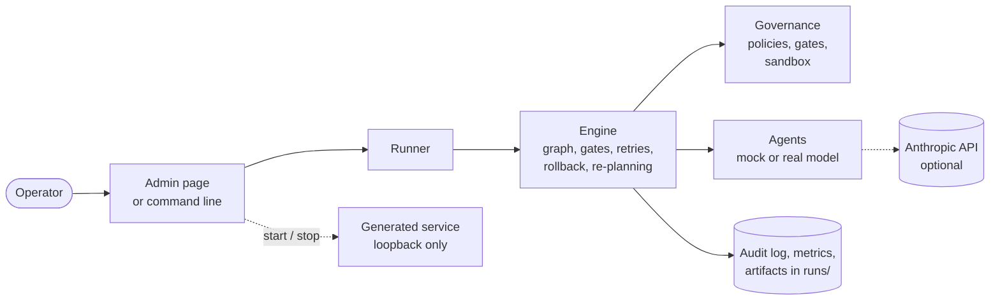
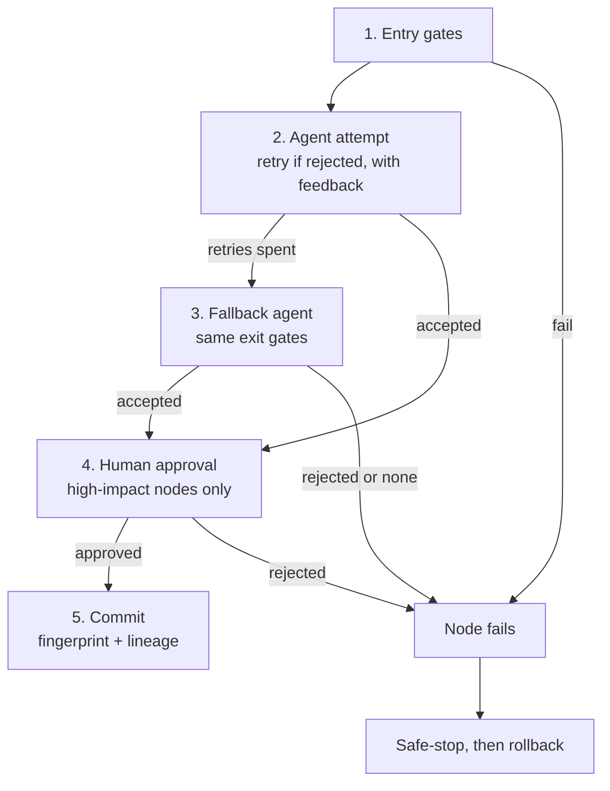
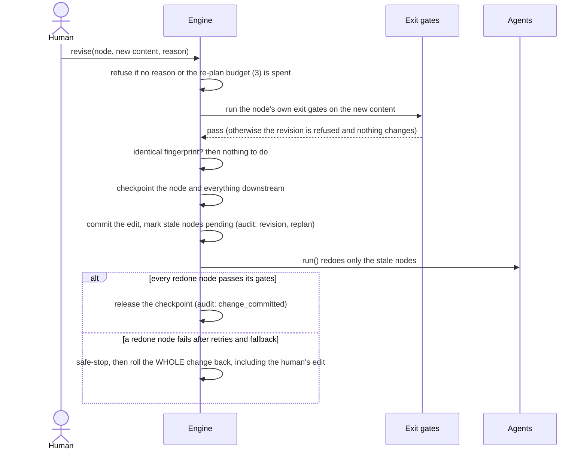
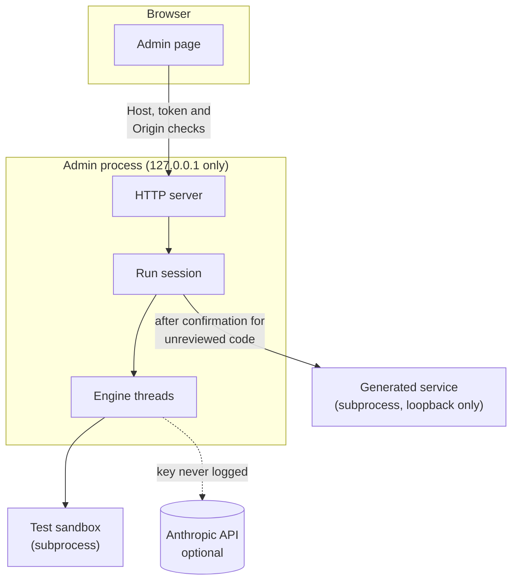
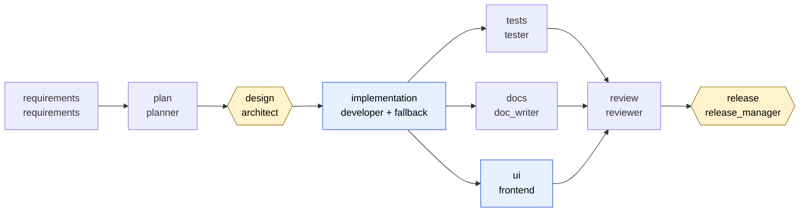

# Agent Orchestrator: architecture overview

*Describes version 0.6.0. Companions: [architecture-reference.md](architecture-reference.md) (diagrams and tables generated from the code), [requirements-traceability.md](requirements-traceability.md), [policies.md](policies.md), and the decision records in [decisions/](decisions/).*

## 1. What it is, and the principles behind it

Agent Orchestrator turns a requirement into a reviewable engineering outcome (requirements, plan, design, code, tests, documentation, web UI, review, release readiness) by running **agents under explicit controls**. Agents do the work; the system decides whether the work is accepted; humans own the approvals and the final judgement.

| Principle | What it means in the design |
|--------------------------|--------------------------------------------------------------------------|
| **Controlled autonomy** | No output is committed unless every gate passes. High-impact stages (design, release) need a human. |
| **Policy as code** | Every rule is a named policy with a category and a test. A block always says which rule fired, as `[category/policy-id] message`. |
| **Fail closed** | Missing evidence blocks. A check that crashes rejects. A workflow missing a mandatory control refuses to start. |
| **Everything is evidence** | A hash-chained audit log is the single source for metrics, the live feed and the report. |
| **One code path** | The command line, the tests and the admin page all call the same runner and engine. |
| **The engine knows nothing about software** | It executes a dependency graph with injected agents and gates; the software-delivery meaning lives in the workflows. |
| **Offline by default** | Agents are mocks unless you choose a real model; a real model is a drop-in behind one interface. |

## 2. System context



An operator starts a run from the admin page or the command line. Both call the runner, which builds the workflow, runs the engine, and writes the audit log, metrics, report and artifacts under `runs/<id>/`. The admin page can then start the service that was built.

## 3. Components and layers

| Layer | Where | Responsibility | Depends on |
|--------------|--------------------------|------------------------------------------|------------------|
| **Engine** | `orchestrator/core` | Graph, node states, parallel scheduler, retries, fallback, approvals, checkpoint and rollback, fingerprints and re-planning | standard library only |
| **Governance** | `orchestrator/governance` | <!--GEN:policy-factories-->36<!--/GEN--> policy factories plus 3 workflow-lint rules, gates, the test sandbox, AST code analysis, approval helpers | standard library only |
| **Agents and LLM** | `orchestrator/agents`, `orchestrator/llm` | One interface `complete(role, prompt)`; mock, real (Anthropic) and hybrid routing; output contracts; recording | standard library only |
| **Observability** | `orchestrator/observability` | Hash-chained audit log; metrics computed from it | governance (one helper) |
| **Workflows** | `orchestrator/workflows` | The graphs: greenfield, brownfield, ambiguous and a toy; the reference artifacts the mock agents return | engine, governance, agents |
| **Runner and CLI** | `runner.py`, `cli.py` | Assemble, run, and persist artifacts, metrics and report | all of the above |
| **Admin** | `orchestrator/admin` | Local web server, run session with blocking human decisions, service launcher | runner, workflows, llm |

Dependencies point downward. The engine imports nothing outside itself: agents, gates, the approval hook and the audit sink are all *injected*. The single deliberate exception is that metrics reuses the policy-id parser. `simple_graph/` is a small LangGraph-style version kept as a teaching aid; nothing else uses it.

## 4. Orchestration model

**Graph and nodes.** A workflow is an explicit dependency graph (validated acyclic). A node has an agent, its dependencies, entry gates, exit gates, an approval flag, a retry budget, an optional fallback agent, and governance tags (`code`, `high_impact`, `release`).

**Scheduling.** The engine runs in **waves**: every node whose dependencies are done runs in parallel in a thread pool (4 workers by default), the wave ends at a barrier, and the next wave is computed. Agents see a read-only snapshot of committed outputs; commits happen under a lock. This keeps behaviour deterministic and easy to audit, at the cost of a slow node delaying its siblings' successors (section 11).

**One node, end to end.** A node runs its entry gates, then agent attempts judged by its exit gates, then a human approval if it needs one, then commits (picture below). When something fails, the **resilience ladder** applies: retry (bounded, 2 retries by default, optional exponential backoff, with the rejection fed back to the agent), then fallback (a different agent, judged by the *same* gates; a node without one fails here), then safe-stop (first reason wins; a global budget of 50 attempts bounds the whole run), then rollback of any in-flight change. Node states: `PENDING`, `RUNNING`, `AWAITING_APPROVAL`, `DONE`, `FAILED`, `REJECTED`, `SKIPPED`, `ROLLED_BACK`. A run ends `COMPLETED` or `HALTED`.

**A worked example, from a real run.** The developer agent's first answer leaks an API key. The security gate rejects it *by name*, the rejection is fed back, the retry passes, and the unsafe version is never committed or seen by any downstream stage. This block is produced by actually running the workflow:

<!-- BEGIN GENERATED: trace-secret -->
```text
$ python -m orchestrator.cli run shortener --approve auto --violate secret
Running: implementation
implementation: attempt 1 (primary) rejected: [security/no-hardcoded-secrets] possible hardcoded secret (pattern 0); [security/no-hardcoded-secrets] possible hardcoded secret (pattern 1) - retrying
implementation done (by developer)
run status: COMPLETED   retries: 1   policy violations: security/no-hardcoded-secrets: 1
```
<!-- END GENERATED: trace-secret -->

The same flow as a picture:



## 5. Dynamic change: fingerprints, re-planning and rollback

Every committed output has a **content fingerprint** (sha256), and every node records the fingerprints of all its ancestors at the time it ran. `Engine.revise()` replaces an upstream output, for example a human changing an answer, and the engine works out the affected nodes by comparing fingerprints. An identical revision changes nothing.



Revisions obey the same governance as normal work: a stated reason, the re-plan budget, the node's exit gates (so a contradictory human answer is refused by the same policy that would refuse an agent's), and all-or-nothing rollback. Tracking *all* ancestors is conservative: it can redo a node that never read the changed input, but it can never skip one that did ([ADR 004](decisions/004-fingerprint-based-replanning.md)).

## 6. Governance architecture

Policies are small named rules (`Policy(id, category, check)`), grouped in sets and attached to stages as gates. Each category judges a different *subject*:

| Category | Subject it reads | Examples |
|---|---|---|
| **security** | source code or HTML/JS as text | no hard-coded secrets, no `eval`/`subprocess`, stdlib-only dependencies, no `innerHTML`, no external resources |
| **compliance** | a map of artifacts (`implementation`, `tests`, `docs`, ...) | public API documented, minimum tests, release evidence complete, no silent assumption of a high-risk answer, decisions visible in code, plan traceable to tests |
| **change control** | a change set (baseline vs proposed), or the workflow graph | size limits, protected paths, backward-compatible public API, patch confined to its declared impact, mandatory controls present |

Beyond the policies, the architecture has four structural guarantees:

- **Gate adapters** turn a policy set into an entry or exit gate; every violation renders as `[category/id] message`, which is what the audit log, the metrics and the activity feed key on.
- **Workflow lint** runs before anything executes and refuses a workflow whose tagged stages lack their mandatory control (a `code` stage must have a security gate; a `high_impact` stage must need approval; a `release` stage must have a compliance entry gate).
- **Fail closed** everywhere: compliance policies treat a missing artifact as a violation; a gate that raises rejects; an unparseable plan or answer blocks.
- **Defence in depth**: the release stage re-verifies all evidence itself instead of trusting upstream stages, and the service launcher re-runs the security policies on the file immediately before starting it.

Every control on every stage of the greenfield workflow, read from the real graph (the other workflows are in the reference):

<!-- BEGIN GENERATED: controls-shortener -->
| Stage | Controls that must pass | Human |
|---|---|---|
| `requirements` | json_has_keys(goal, functional, ambiguities, acceptance) | - |
| `design` | entry: require_inputs(requirements) | approval |
| `implementation` | valid_python, no-hardcoded-secrets, no-dangerous-calls, no-unsafe-imports, dependency-allowlist, public-api-documented, max-files-changed, max-lines-changed, protected-paths, no-file-deletion | - |
| `tests` | valid_python, tests_pass_against_implementation, minimum-tests, traceability-evidence-exists | - |
| `docs` | docs-cover-public-api | - |
| `review` | reviewer_approves | - |
| `release` | entry: release-evidence | approval |
| `plan` | plan-well-formed, plan-maps-to-workflow, plan-sequencing-matches-graph, acceptance-criteria-traced | - |
| `ui` | no-hardcoded-secrets, ui-no-external-resources, ui-no-unsafe-dom-sinks, ui-no-inline-event-handlers, ui-no-inline-style-attributes, ui-csp-compatible-blocks, ui-uses-documented-api, ui-accessibility-basics, max-files-changed, max-lines-changed, protected-paths, no-file-deletion | - |
<!-- END GENERATED: controls-shortener -->

In total there are <!--GEN:policies-->39<!--/GEN--> named controls. The exact controls on every stage of every workflow are generated in [architecture-reference.md](architecture-reference.md); the rationale is in [policies.md](policies.md) and [ADR 002](decisions/002-policy-as-code.md).

## 7. Human oversight, the admin page and trust boundaries

Human decisions use three hooks the engine already has: `approver(node, output) -> bool`, `asker(question) -> answer | None` (only the clarification stage uses it), and `Engine.stop()`. The command line implements them with prompts; the **admin page** implements them as *waiting decisions*: the run thread blocks until the page answers. So everything a person can do on the page, the engine already supported.

Questions are **risk-graded**: only a person can answer a high-risk question; an agent may assume a low- or medium-risk one but must record why. With nobody available the run stops safely rather than guessing ([ADR 005](decisions/005-human-decisions-and-traceability.md)).

The admin page is a thin layer: a standard-library web server, one active run at a time (state in memory), and the page, which polls about every 0.7 s. It is a **local tool**, and its trust boundaries are explicit:



| Boundary | Control |
|---|---|
| Browser to server | loopback only; `Host` allow-list (DNS rebinding); per-start token and `Origin` check on every state change; 64 KB request limit; hash-based Content-Security-Policy |
| Run to the model API | key from the environment or pasted into memory; never written to disk, logs, recordings or responses; call budget; explicit consent in real mode |
| Run to the sandbox | isolated subprocess (`python -I`), timeout; not a hard security boundary |
| Run to the generated service | every `bind` forced onto loopback; credential-like variables scrubbed; own folder; policies re-run; whole process tree stopped on exit; confirmation for real-model or unknown-origin code |

## 8. Observability and audit

Every significant step is an **event** in `audit.jsonl`: <!--GEN:events-->22<!--/GEN--> event types, catalogued in the reference. Each record carries a sequence number and the hash of the previous record (sha256), so the log is a **tamper-evident chain**: `AuditLog.verify` recomputes it, and the admin page offers the check. It detects any edit; it is not tamper-*proof*, because someone who rewrote the whole chain could not be caught without anchoring the final hash elsewhere (a production step).

Metrics are derived *only* from these events, never kept separately. The ones the brief names:

| Metric | Definition |
|---|---|
| Success rate | nodes in state `DONE` at the end of the run / all nodes |
| Retry frequency | failed attempts that were followed by another attempt of the same agent |
| Rollback frequency | failed changes reverted to a checkpoint (also `fallbacks`, `revisions`, `nodes_replanned`) |
| MTTR | mean time from a node's first failed attempt to its next successful commit (unrecovered nodes excluded) |
| End-to-end latency | wall-clock time of the last `run()` |

Further metrics: policy violations by policy id (once per blocked output), model calls and tokens. **Decision lineage**: every output records which inputs it derived from and which agent produced it (`human` for an edited answer); revisions record who, why, and old and new fingerprints; the run report has a lineage section.

## 9. The three scenarios as instances of one engine

| Scenario | What it adds to the common pipeline | Key controls |
|---|---|---|
| **Greenfield** (URL shortener) | `plan` stage (tasks, ordering, traceability), parallel `tests` / `docs` / `ui`, a join at `review` | plan well-formed and executable; every acceptance criterion traced to a real test; UI security and accessibility; release evidence re-verified |
| **Brownfield** (BUG-142) | `impact_analysis` first; the patch is judged against the baseline | impact analysis grounded in real symbols; patch confined to declared impact; public API compatible; a new test must fail on the old code; no test removed |
| **Ambiguous** ("make links expire sensibly") | `clarifications` (human decisions) alongside the analysis | high-risk answers only by a human; answers within options and consistent; decisions visible in code; later changes re-planned automatically |

The greenfield graph, generated from the real workflow definition (the others are in the reference):

<!-- BEGIN GENERATED: graph-shortener -->


*Hexagons need a human approval; blue boxes produce code and carry a security gate; the arrows are dependencies (redundant ones omitted).*
<!-- END GENERATED: graph-shortener -->

## 10. Agents and the LLM layer

Every agent calls one method, `complete(role, prompt) -> str`, so the model is swappable without touching workflows.

- **Mock** (default): returns stored, reviewed artifacts per role. It can inject failures and scripted policy violations, and its answers can be functions of the prompt, so changing a human's answer genuinely changes the generated design, code and tests.
- **Real** (Anthropic Messages API, standard library only): each role has an **output contract** stating what its gates enforce; chat packaging (fences, preamble) is removed without altering clean artifacts; a retry carries the rejection reason and the previous output; hard budgets on calls and output size; transient errors retried, authentication errors fatal; truncated answers rejected; every call logged (role, model, tokens, latency, prompt hash).
- **Hybrid and recording**: send only chosen roles to the real model; record every prompt and response for debugging.

The real-model path is tested through a fake Anthropic server with the same wire format; it has not been exercised against the live API in the build environment ([ADR 006](decisions/006-real-llm-integration.md)).

## 11. Key decisions and trade-offs

| Decision | Why | Alternative not taken | Where |
|------------------------|--------------------------------|--------------------------------|------------|
| Custom engine, not LangGraph | The controls the brief asks for (gates, rollback, lineage, budgets) are first-class here, not bolted on | LangGraph as the base; kept only as a small explainer in `simple_graph/` | this document |
| Resilience ladder | Each rung has one precise meaning and is separately measurable | a single generic "retry" | [ADR 001](decisions/001-resilience-ladder.md) |
| Policy as code with ids and a lint | Per-rule audit and metrics; governance cannot be configured away | ad hoc checks in gates; an external engine (OPA) as too heavy for a prototype | [ADR 002](decisions/002-policy-as-code.md) |
| Declare the blast radius, then enforce it | Deterministic, explainable scope control in existing code | trusting a reviewer agent; line-based diffs | [ADR 003](decisions/003-brownfield-declare-then-enforce.md) |
| Fingerprint re-planning | Minimal, explainable rework with no manual switch | always redo everything | [ADR 004](decisions/004-fingerprint-based-replanning.md) |
| Humans decide by risk | Keeps people on the decisions that matter | block on every ambiguity; let the model ask freely | [ADR 005](decisions/005-human-decisions-and-traceability.md) |
| Real LLM behind the same interface | Same governance applies unchanged | an SDK-specific integration | [ADR 006](decisions/006-real-llm-integration.md) |
| Thin local admin page; launch with enforced limits | One window for the demo without new logic or dependencies | a framework and front-end build; a container | [ADR 007](decisions/007-admin-page.md), [ADR 008](decisions/008-launching-generated-services.md) |
| Wave scheduler with a barrier | Simple, deterministic, easy to audit | an event-driven scheduler (a slow node would no longer delay unrelated successors) | this document |
| Standard library only | Zero installation; runs anywhere | web and HTTP frameworks (less code, more dependencies) | this document |
| Hash-chained file for audit | Offline, simple, tamper-evident | a database | this document |
| Run state in memory | Simplicity | persisted state with crash-resume | this document |
| Mock-first testing | Deterministic, free, offline | testing only against a live model | [testing.md](testing.md) |

## 12. Quality attributes and how to extend

| Attribute | How it is achieved |
|---|---|
| **Testability** | Dependencies are injected (clock, transport, agents, approver); over 350 automated tests; key guards were verified by deliberately breaking them ("mutation checks"); the page's script is run against a real server |
| **Reliability** | The resilience ladder, bounded budgets, checkpoint and rollback, and process-tree cleanup; three Windows-only bugs found by real runs are covered by regression tests ([testing.md](testing.md)) |
| **Security** | Fail closed, named policies, the trust boundaries in section 7, secrets never logged, an explicit consent step for real models |
| **Extensibility** | *New policy:* a factory returning a `Policy`, added to a set (the catalogue discovers it automatically). *New workflow:* a `build()` returning a graph and agents, plus reference artifacts for the mock. *New agent role:* `llm_agent(...)` plus a contract |

## 13. Limits and evolution

- **Mock agents unless a real model is chosen:** the mock proves the governance, not generation quality; the real path is untested against the live API here.
- **State is in memory:** a crash loses a run in progress (finished runs are on disk). Crash-resume needs persisted state.
- **Wave scheduling, one run at a time, one machine.**
- **The test sandbox is an isolated subprocess, not a container;** launched services run with the user's permissions (hence the confirmation).
- **Static analysis only** (AST and patterns): it raises the bar but does not replace a real SAST tool or review.
- **Audit chain is tamper-evident, not tamper-proof** without external anchoring.
- **Next steps:** persisted run state and resume, an event-driven scheduler, containerised sandboxing, a signed and anchored audit trail, authentication and multi-user support.
